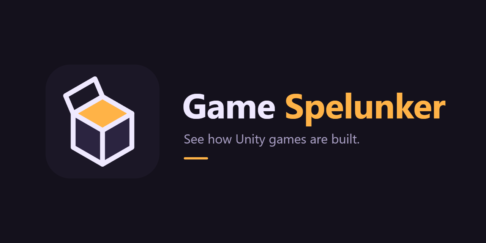

<p align="center">
  
</p>

<p align="center">
  
  <a href="https://github.com/AssetRipper/AssetRipper/releases/tag/2.0.0"></a>
  
  <a href="LICENSE"></a>
</p>

**Game Spelunker** is a Unity Editor tool to see how Unity games are built and to prepare mods for games that
allow them. It reads a game's build to tell you what it is made of, extracts it with
[AssetRipper](https://github.com/AssetRipper/AssetRipper), lets you import the result into the project you are
working on, and helps you explore the decompiled scripts.

> [!WARNING]
> **Use it responsibly.** Only extract games you own. Extracted assets and code still belong to their authors: use
> them to learn or to build mods the developer allows, never redistribute them, and respect each game's license
> (EULA). Online games with anti-cheat may ban accounts for modified files.

<p align="center">
  
  &nbsp;
  
</p>

## Install

In Unity **6000.3 or newer**: **Window → Package Manager → + → Install package from git URL…** and paste:

```
https://github.com/Nekuzaky/unity-game-spelunker.git?path=Packages/com.nekuzaky.game-spelunker
```

Then open **Tools → Game Spelunker** (`Ctrl+Shift+G`). That's all: accept the usage notice the first time, and
AssetRipper (44 MB, from github.com/AssetRipper) is downloaded by itself on your first extraction.

This URL installs the latest version. Unity then keeps that exact version until you update: to get a newer one,
paste the same URL again in **Install package from git URL…**. To stay on a specific version, add its tag at the
end, for example `…game-spelunker#v0.3.0`.

Tested with Unity 6000.3.13f1 and 6000.5.9f1. Full documentation: **https://nekuzaky.com/docs/unity-game-spelunker**

## Features

- **Find games** — lists the Unity games installed through Steam (all libraries), Epic Games, GOG and itch.io, or pick any folder.
- **Build report** — without running the game: Unity version (and whether you have it), Mono / IL2CPP, render pipeline,
  scenes, size, asset bundles, game assemblies, native plugins, installed mod loaders (BepInEx, MelonLoader, Doorstop…).
- **Nothing else to install** — the official AssetRipper release is downloaded on the first extraction (never bundled),
  on Windows, macOS and Linux, or you point to a copy you already have.
- **The game's own Unity** — install the exact Unity version a game was made with through Unity Hub, in one click.
  With it, the game's original libraries and compiled shaders are kept, so the project looks and behaves like the game.
- **Extract into a ready project** — as a Unity project (scenes, prefabs, materials, decompiled scripts) or as raw assets
  (PNG, models, sounds). Each stage shows its time and an estimate of the time left; queue several games; get notified
  when it ends.
- **Code that compiles** — decompiled code is rewritten for removed Unity APIs, then compiled in the background
  (a quick compiler first, Unity confirming) until it compiles; what could not be decompiled is stubbed and listed.
- **Materials and shaders repaired** — kept game shaders are probed and only those that need the game running fall
  back to the repair; Unity's built-in shaders come back as real source, interface and text shaders are regenerated,
  the rest is rebuilt on Standard, URP or HDRP Lit.
- **Checked in Play mode** — a background Play run with screenshots and an error count, shown as a health dashboard
  with a copyable report.
- **Import into your project** — copies the extracted assets into `Assets/Spelunked/<Game>` of the project you have open,
  keeping references between assets.
- **Explore** — open the export in the matching Unity version (on the game's biggest scene), see what's inside by asset
  type, open any scene, preview textures, see the plugins and middleware the game uses, search the game's scripts and
  open them in your code editor.
- **Manage your extractions** — sizes, free the Unity cache, delete, reopen; settings for the output folder, shaders,
  game code mode, checks and notifications.

## Importing into your project

The **Import into this project** section (step 4) is built so it can never break the project you are working in:

- Everything goes into its own folder (`Assets/Spelunked/<Game>` by default), with the original `.meta` files so prefabs,
  materials and textures stay linked.
- Never imported: engine shaders, compute shaders, native plugins, `Editor` folders, `StreamingAssets` and project
  settings. Nested `Resources` folders are renamed so they don't end up in your builds.
- Files whose GUID already exists in your project are skipped and counted.
- **Scripts are optional.** When included, they go into one assembly that only compiles once you add the scripting
  define shown in the window (*Project Settings → Player → Scripting Define Symbols*). Until then you can read them, and
  prefabs keep their script references, but they can't stop your project from compiling.
- Packages the game used that your project lacks (TextMeshPro, Cinemachine…) are listed so you can add them.

## Usage

1. **Game** — *Find Unity games on this PC* or *Choose folder…* (the folder with the game's `.exe` and `*_Data`).
2. **Build report** — read what the game is made of.
3. **Extract** — choose *Unity project* or *Raw assets* and an output folder, then **Extract**. The first extraction
   downloads AssetRipper.
4. **Explore** — **Open in Unity** opens `ExportedProject` in the right Unity version, or **Import into this project**.
   Click a script to open it in your code editor, or an asset type to show it in Explorer.

Mono builds give fully decompiled scripts. IL2CPP builds give classes, fields and method signatures, but empty method
bodies: scenes and assets come back, the game's logic does not run.

## How it works

Game Spelunker starts AssetRipper headless on a free local port and drives its HTTP API: `POST /Settings/Update`
(compiled shaders kept when the game's Unity is installed, decompiled or original assemblies), `POST /LoadFolder` with
the game folder, then `POST /Export/UnityProject` or `POST /Export/PrimaryContent`. The build report is read straight
from the game files (`globalgamemanagers` header, `app.info`, `Managed/`, `il2cpp_data/`, `Plugins/`).

After the export, the project is prepared from disk (API migration, original libraries, native plugins, shader
restoration, assembly definitions, `steam_appid.txt`), the game's code is compiled in a loop until it builds, and the
project is opened in the right Unity in batch mode to import every asset, repair materials and run a Play-mode check.

## Repository layout

The repository root is the Unity project used to develop the package.

```
Packages/com.nekuzaky.game-spelunker/   the package users install
  Editor/SpelunkerWindow*.cs            the window (UI Toolkit) and Spelunker.uss
  Editor/BuildInspector.cs              build report from game files
  Editor/GameFinder.cs                  installed Unity games (Steam, Epic, GOG, itch.io)
  Editor/AssetRipperInstaller.cs        download / locate AssetRipper
  Editor/AssetRipperSession.cs          run AssetRipper headless and drive its HTTP API
  Editor/UnityEditorInstaller.cs        install the game's Unity version through Unity Hub
  Editor/ExtractedProject.cs            prepare an export for opening, editor lookup, import and repair
  Editor/GameCodeCompiler.cs            make the decompiled code compile
  Editor/MaterialRepair.cs              material repair and render probe (also copied into exports)
  Editor/ShaderRestorer.cs              built-in and interface shaders restored as source
  Editor/BuiltinShaders.cs              Unity's official built-in shader source, per version
  Editor/ProjectChecker.cs              background Play-mode check
  Editor/SpawnScanner.cs                objects the game spawns from code
  Editor/ProjectImporter.cs             safe import into the open project
  Editor/ExtractedProjectTools~/        editor tools copied into extracted projects
Assets/Dev/Editor/                      smoke test and README screenshots (not in the package)
TestGame/                               a tiny Unity game built for testing
docs/brand/                             logo and banner (SVG + PNG)
```

## Development

```
Unity -batchmode -projectPath TestGame -executeMethod BuildTestGame.Build
Unity -batchmode -projectPath . -executeMethod GameSpelunker.SpelunkerSmokeTest.Run -gsGame TestGame/Build -gsOut <empty folder>
```

The smoke test inspects the test game, extracts it, imports it into the project (scripts included) and checks that
everything came back. See [CONTRIBUTING.md](CONTRIBUTING.md) before opening a pull request.

## Support the project

If Game Spelunker helps you, you can support its development on
[Patreon](https://www.patreon.com/Nekuzaky) or [Buy Me a Coffee](https://www.buymeacoffee.com/Nekuzaky). Stars help too!

## Credits

- Extraction by [AssetRipper](https://github.com/AssetRipper/AssetRipper) (GPL-3.0), downloaded separately.
- Unity's built-in shader source is downloaded from Unity when needed (see `Third Party Notices.md` in the package).
- Icons in the window are Unity's built-in editor icons.
- Game Spelunker is not affiliated with Unity Technologies or with the AssetRipper project.

## License

[MIT](LICENSE) © Nekuzaky
