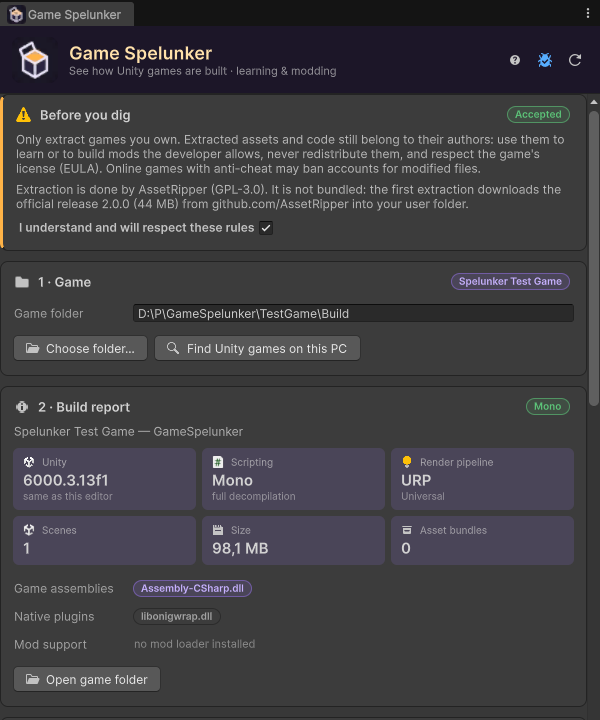

# Getting Started

This page takes you from an empty window to an extracted game you can explore. It takes a couple of minutes, plus the time AssetRipper needs for the game you choose (a few seconds for a small game, several minutes for a large one).

## 1. Open the window

**Tools → Game Spelunker**, or `Ctrl+Shift+G`. The window is made of cards, one per step, from top to bottom.

## 2. Accept the usage notice

The first card, **Before you dig**, sums up the rules: only extract games you own, never redistribute what you extract, respect the game's license. Tick **I understand and will respect these rules**. Extraction stays disabled until you do. More in **[Responsible Use](Responsible-Use)**.

## 3. Choose a game

In **1 · Game**:

- click **Find Unity games on this PC** to list the Unity games installed through Steam, Epic Games, GOG and itch.io, then click one; or
- click **Choose folder…** and select the folder that contains the game's `.exe` and its `<Game>_Data` folder.

Details in **[Finding Games](Finding-Games)**.

## 4. Read the build report

**2 · Build report** appears as soon as a game is selected. It is read from the game's files — nothing is run:

The badge next to the title says whether the game uses **Mono** (scripts can be fully decompiled) or **IL2CPP** (only the structure of the code can be recovered). Every field is explained in **[Build Report](Build-Report)**.

## 5. Extract

In **3 · Extract**:

1. Choose what to export: **Unity project** (the whole game as a project you can open) or **Raw assets** (plain files).
2. Keep the suggested output folder (`Documents\Game Spelunker\<Game>`) or click **Choose output…**.
3. Click **Extract**.

The very first time, Game Spelunker downloads AssetRipper (44 MB on Windows) from GitHub before extracting — once per computer, nothing to click. See **[AssetRipper](AssetRipper)**.

A progress bar shows the loading and exporting steps, and **AssetRipper log** shows its output. **Cancel** stops everything. See **[Extracting](Extracting)**.

## 6. Explore

When the extraction is done, **4 · Explore** appears:

- **Open in Unity** opens the extracted project in a new Unity window, with the game's Unity version when you have it installed — see **[Opening the Project](Opening-the-Project)**.
- **Import into this project** copies the assets into the project you have open — see **[Importing into Your Project](Importing-into-Your-Project)**.
- **What's inside** lists the asset types with their counts; click one to show its folder.
- **Game scripts** lists the game's own code; click a script to open it in your code editor — see **[Exploring Scripts](Exploring-Scripts)**.

> [!TIP]
> Game Spelunker remembers the last game you selected. Next time you open the window, its report and its extraction are already there.
