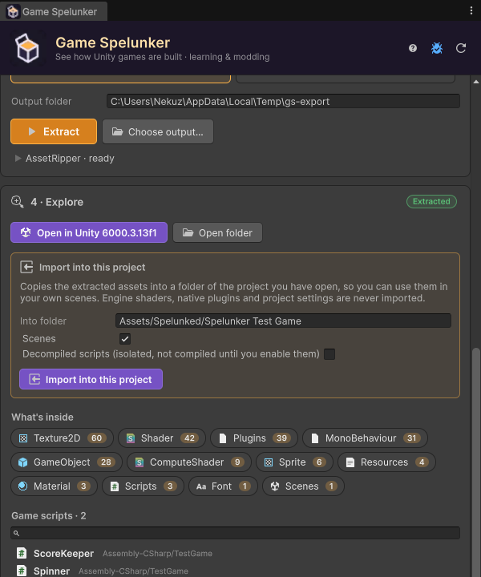

# Importing into Your Project

**Import into this project** copies the assets of an extraction into the project you have open, so you can study them next to your own work or use them in a mod you are building. It is built so that it can never break that project.

> [!WARNING]
> Importing does not change who owns the assets. Only use them in a project of yours for learning or for a mod the developer allows, and never publish them. See **[Responsible Use](Responsible-Use)**.

## Importing

1. Extract the game as a **Unity project** (see **[Extracting](Extracting)**).
2. In **4 · Explore → Import into this project**, check the destination in **Into folder** — by default `Assets/Spelunked/<Game>`.
3. Choose what to bring:
   - **Scenes** — on by default.
   - **Decompiled scripts** — off by default; see below.
4. Click **Import into this project**.

When it's done, a summary tells you how many files were copied, what was skipped and why, and the Project window highlights the new folder.

## What is imported, and what never is

Everything goes into its own folder, together with the original `.meta` files, so prefabs, materials, textures and meshes stay linked to each other exactly as in the game.

| Never imported | Why |
| :--- | :--- |
| **Shaders and compute shaders** | They are copies of the engine's own shaders and would clash with the real ones. |
| **Native plugins** | Platform libraries that could load into your editor. |
| **Editor folders, Gizmos, StreamingAssets** | They have special meanings in Unity and could change how your project behaves. |
| **Project settings** | Tags, layers, physics and quality settings stay yours. |

Folders named **Resources** inside the import are renamed `Resources (imported)`: Unity puts every `Resources` folder into your builds, and you don't want the game's assets in yours.

## Materials repaired

Since the game's shaders are not imported, its materials would show pink. Right after copying, Game Spelunker moves them to real shaders of your project's render pipeline: back on the stock Unity shader when the game used one, otherwise on *Standard*, *Universal Render Pipeline/Lit* or *HDRP/Lit* with their textures (color, normal, occlusion, emission), cut-out for foliage and transparency for glass. The import message says how many were repaired. The same repair is available on any folder: **right-click → Game Spelunker → Repair Materials**. See **[Opening the Project](Opening-the-Project)** for the details.

## GUID conflicts

Every Unity asset has a unique identifier (GUID) in its `.meta` file. If an imported file has a GUID that already exists in your project, copying it would silently redirect references in **your** assets to the game's file. Game Spelunker skips those files and tells you how many were skipped.

## Scripts: isolated and switched off

Decompiled code rarely compiles as-is, and its class names may clash with yours. A single compile error stops the whole project from compiling, so imported scripts are handled carefully:

- they are only imported if you tick **Decompiled scripts**;
- they go into one dedicated assembly, `Spelunked.<Game>`, separate from your code;
- that assembly **only compiles when you add a scripting define**, shown in the window — for example `SPELUNKER_COMPILE_MY_GAME`.

Imported scripts never run in edit mode either: `[ExecuteInEditMode]` and `[ExecuteAlways]` are removed, as in an extracted project.

Until you add the define, the scripts are just text you can read, prefabs keep their references to them, and nothing can break. When you want to try compiling them, add the define in **Project Settings → Player → Other Settings → Scripting Define Symbols**, fix the errors that appear, or remove the define again.

## Missing packages

If the game used packages your project does not have (TextMeshPro, Cinemachine, Input System…), the summary lists them. Add them with the Package Manager if some imported assets look broken.

## Newer Unity versions

When the game was made with a newer Unity version than your editor, a warning appears: assets saved by a newer Unity may not import correctly in an older one.

## Removing an import

Delete the import folder (by default `Assets/Spelunked/<Game>`). If you had added the scripting define, remove it too.
